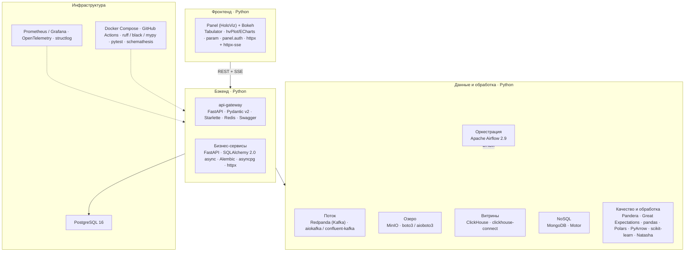
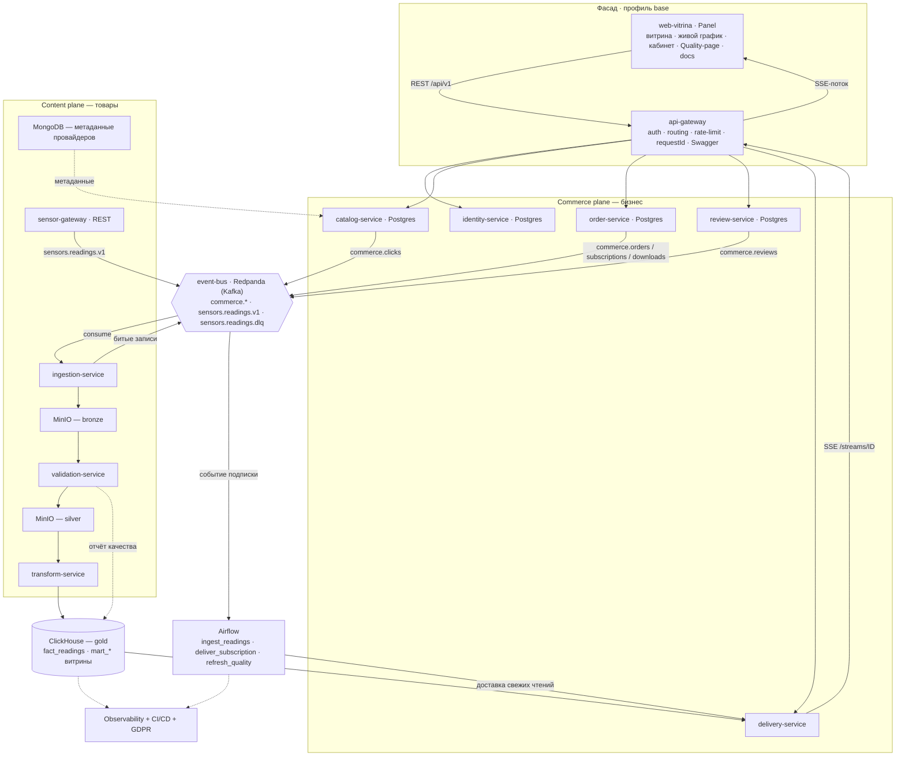

---
tags:
  - ДДЕ
  - data-engineering
  - ТЗ
  - микросервисы
  - спецификация
status: черновик
links:
  - "[[Проект платформы/Маркетплейс данных — концепция портала (вариант Б)]]"
  - "[[Силабус ДДЕ 2025 два уровня]]"
  - "[[Семинары — Сквозной пайплайн]]"
---

# ТЗ — Демо-портал «Спутник Данные» (по принципам SDD)

> **SDD (Specification-Driven Development):** документ специфицирует поведение до реализации. Каждый компонент описан контрактами — ответственность, данные, API/события, критерии приёмки. API-контракты формализуются в OpenAPI 3.x, event-контракты — в AsyncAPI. Фейковые данные генерируются модулями генерации по детерминированным схемам.

## 1. Назначение

Учебный демо-портал-маркетплейс данных для курса «Инжиниринг данных» (ДДЕ). Один портал обслуживает **оба уровня**:

- **Базовый** — студент-покупатель работает с витриной/API/кабинетом (фасад).
- **Продвинутый** — студент-инженер строит и разбирает пайплайн за фасадом (две нити данных).

**Цели:**
- Дать студентам целостную, узнаваемую платформу, где каждая тема курса — сценарий взаимодействия.
- Показать «путешествие события» от источника до метрики/пользователя на реальных микросервисах.
- Воспроизводимость и безопасность: все данные фейковые, генерируются детерминированно.

**Не-цели:** продакшн-нагрузка, реальное железо, отказоустойчивость уровня enterprise, многопользовательский доступ на тысячи RPS.

### 1.1 Технологический стек

Единая база — **Python-монорепозиторий**: сервисы, пайплайны, генераторы и фасад написаны на одном языке, чтобы стек поднимался одной командой и читался студентами обоих уровней. Backend строится вокруг **FastAPI + SQLAlchemy/Alembic**; фронтенд — на **Python + Panel** (обоснование ниже).



#### Backend и данные (базовая линия)

| Слой            | Технология                                                      | Что закрывает                                  |
| --------------- | --------------------------------------------------------------- | ---------------------------------------------- |
| Язык/рантайм    | Python 3.12, `uv` (пакеты, src-layout)                          | единый рантайм сервисов, DAGов и генераторов   |
| Web             | FastAPI + Starlette, Uvicorn/Gunicorn                           | REST/SSE, async-эндпоинты, автодок OpenAPI     |
| Схемы/конфиг    | Pydantic v2, pydantic-settings                                  | контракты запросов/ответов, конфиг из env      |
| ORM/миграции    | SQLAlchemy 2.0 (async) + Alembic, asyncpg                       | доступ к Postgres, версионные миграции         |
| Кэш/лимиты      | Redis 7 + redis-py                                              | rate-limit, идемпотентность, сессии            |
| HTTP-клиент     | httpx (+ httpx-sse)                                             | вызовы между сервисами, чтение SSE             |
| События         | Redpanda (Kafka API) + aiokafka/confluent-kafka                 | `commerce.*`, `sensors.readings*`, DLQ         |
| Озеро           | MinIO + boto3/aioboto3 (S3 API)                                 | bronze/silver/отчёты/выгрузки                  |
| Качество данных | Pandera + Great Expectations                                    | схемы слоёв, аномалии, отчёты                  |
| Обработка       | pandas + Polars + PyArrow (Parquet)                             | очистка, трансформации, форматы                |
| ML/фичи/NLP     | scikit-learn, statsmodels, Natasha/pymorphy (опц. transformers) | временные ряды, сентимент                      |
| Warehouse       | ClickHouse + clickhouse-connect                                 | витрины gold, аналитика                        |
| NoSQL           | MongoDB + Motor                                                 | метаданные провайдеров                         |
| Оркестрация     | Apache Airflow 2.9                                              | DAGи, retries/backoff, сенсоры                 |
| Наблюдаемость   | structlog, OpenTelemetry, prometheus-client, Grafana            | логи по `requestId`, метрики лага/свежести     |
| Тесты           | pytest, pytest-asyncio, testcontainers, schemathesis            | unit + контрактные тесты живых сервисов        |
| Линт/типы       | ruff, black, mypy                                               | единый стиль и статическая проверка            |
| Упаковка/CI     | Docker, docker compose (профили), GitHub Actions                | воспроизводимый запуск, блокировка ломающих PR |

#### Фронтенд фасада — Python + Panel (HoloViz)

`web-vitrina` реализуется на **Panel поверх Bokeh-сервера**, а не как JS-SPA. Это осознанный выбор в пользу одного языка на всём стеке.

| Компонент | Технология | Зачем |
| --- | --- | --- |
| Каркас UI | `panel` (FastListTemplate) | витрина, карточка, кабинет, Quality-page, docs |
| Таблицы | `Tabulator` | каталог, заказы, отзывы с фильтрами и пагинацией |
| Графики | `hvPlot`/`ECharts` (или `plotly`) | часовые ряды, живой график по подписке |
| Состояние/конфиг | `param` | реактивные параметры страниц |
| Аутентификация | `panel.auth` + Bearer к gateway | вход покупателя |
| Клиент API | `httpx` + `httpx-sse` | REST к `api-gateway`, чтение `/streams/{id}` |

**Почему так:** один язык на всём стеке (сервисы, пайплайны, фронт, ноутбуки студентов); в CI нет второй сборки (Node/TS); таблицы, графики и DataFrame-представления — нативные; время до рабочего портала короче.


## 2. Термины и обозначения

| Термин         | Определение                                                                          |
| -------------- | ------------------------------------------------------------------------------------ |
| Content plane  | Нить «товаров» — данные, которые продаются (чтения датчиков, датасеты).              |
| Commerce plane | Нить «бизнеса» — события маркетплейса (клики, заказы, подписки, скачивания, отзывы). |
| Продукт        | Датасет/поток, продаваемый в каталоге.                                               |
| Подписка       | Периодическая доставка свежих чтений подписчику.                                     |
| DLQ            | Dead-letter queue — очередь «битых» записей.                                         |
| Генератор      | Модуль фейковых данных.                                                              |

## 3. Общая архитектура (микросервисы)

Единый `docker compose`; сервисы сгруппированы по ролям.



> **Как читать схему.** `base` поднимает только блок «Фасад» + Postgres; `adv`/`demo` добавляют обе нити, шину, озеро, хранилище и Airflow. Пунктирные стрелки — вспомогательные/асинхронные связи (отчёты, метаданные, observability). Поток подписки: `order-service → Kafka → Airflow → delivery-service → SSE → web-vitrina` — это сквозной сценарий §10.

### Реестр сервисов

| Сервис               | Стек                              | Ответственность                                       | Хранилище          |
| -------------------- | --------------------------------- | ----------------------------------------------------- | ------------------ |
| `web-vitrina`        | Python (Panel, Bokeh)             | Витрина, кабинет, живые графики, docs                 | —                  |
| `api-gateway`        | Python (FastAPI)                  | Маршрутизация, auth, rate-limit, Swagger              | —                  |
| `identity-service`   | Python (FastAPI)                  | Покупатели, токены, API-ключи, PII/GDPR               | Postgres           |
| `catalog-service`    | Python (FastAPI)                  | Каталог датасетов, провайдеры, цены, рейтинг качества | Postgres           |
| `order-service`      | Python (FastAPI)                  | Заказы, подписки, скачивания                          | Postgres           |
| `review-service`     | Python (FastAPI)                  | Отзывы о качестве данных (commerce + NLP-корпус)      | Postgres           |
| `delivery-service`   | Python (FastAPI)                  | Отдача купленных/подписных данных, лимиты             | —                  |
| `sensor-gateway`     | Python (FastAPI)                  | Приём чтений от генераторов провайдеров → Kafka       | —                  |
| `ingestion-service`  | Python (consumer)                 | Kafka → MinIO bronze, DLQ                             | MinIO              |
| `validation-service` | Python (Pandera/GE)               | bronze → silver, аномалии, отчёт качества             | MinIO              |
| `transform-service`  | Python                            | silver → gold (фичи, временные ряды, сентимент)       | MinIO/ClickHouse   |
| `quality-service`    | Python                            | Quality-page, SLA, алерты (observability)             | ClickHouse         |
| `orchestration`      | Apache Airflow                    | DAGи обеих нитей                                      | Postgres (Airflow) |
| `event-bus`          | Redpanda (Kafka) + NATS JetStream | Шины событий                                          | —                  |
| `data-lake`          | MinIO (S3)                        | bronze/silver/gold объекты                            | —                  |
| `warehouse`          | ClickHouse                        | Витрины и отдаваемые датасеты                         | —                  |
| `catalog-nosql`      | MongoDB                           | Гибкие метаданные провайдеров                         | Mongo              |
| `observability`      | Prometheus/Grafana (опц.)         | Метрики, лаги, свежесть                               | —                  |

**Профили запуска:**
- `base` — только фасад: `web-vitrina`, `api-gateway`, `catalog`, `identity`, `order`, `delivery`, Postgres, генератор готовых датасетов. Без Kafka/ClickHouse/Airflow.
- `adv` — полный стек (base + content plane, event-bus, Airflow, ClickHouse, MinIO, Mongo).
- `demo` — как `adv`, но с готовым репозиторием данных для быстрого показа.

### 3.1 Паспорта микросервисов (контракт передачи в разработку)

> Раздел адресован агенту-разработчику. Для каждого сервиса зафиксированы **назначение**, **скоп** (границы ответственности), **применение** (роль в курсе и в сквозном сценарии), а также владение данными, интерфейсы, зависимости и инварианты. Источник истины по API/событиям — `specs/*.yaml`; паспорт объясняет *зачем* сервис нужен и *где проходят его границы*.

**Единый шаблон паспорта**

| Поле | Что фиксирует |
| --- | --- |
| Назначение | Зачем сервис существует, одним абзацем |
| Стек | Ключевые библиотеки/технологии сервиса (детали — §1.1) |
| Скоп — в зоне | Что сервис обязан делать |
| Скоп — вне зоны | Что сервис сознательно **не** делает (уходит соседям) |
| Применение в курсе | К каким лекциям/семинарам и сценариям привязан |
| Владеет данными | Таблицы/объекты, единственным владельцем которых он является |
| Интерфейсы | REST/события, которые он предоставляет или публикует |
| Зависимости | Кого вызывает/читает |
| Инварианты | Правила, обязанные держаться всегда |

#### `web-vitrina`

| Поле | Содержание |
| --- | --- |
| **Назначение** | Фасад маркетплейса на Python/Panel (HoloViz): единственный пользовательский вход (витрина каталога, карточка датасета, живой график, личный кабинет, Quality-page, docs/Swagger). |
| **Стек** | Python 3.12, Panel (HoloViz) + Bokeh, Tabulator, hvPlot/ECharts, param, httpx (+httpx-sse) — см. §1.1 |
| **Скоп — в зоне** | Отрисовка и навигация UI, скачивание файлов, подписка на SSE-поток, отображение качества/SLA. |
| **Скоп — вне зоны** | Любая бизнес-логика и работа с данными — только через `api-gateway`. |
| **Применение в курсе** | Базовый уровень, практики 1–8 (регистрация, витрина, кабинет, дашборд). Демо семинаров 1 и 10. |
| **Владеет данными** | Нет (Panel/Bokeh-сервер; собственного хранилища нет, состояние сессии — в памяти). |
| **Интерфейсы** | Потребляет REST `api-gateway` и SSE `/api/v1/streams/{subscriptionId}`. |
| **Зависимости** | `api-gateway`. |
| **Инварианты** | Прямые обращения к бэкенд-сервисам запрещены; SSE-переподключение идемпотентно по `readingId`. |

#### `api-gateway`

| Поле | Содержание |
| --- | --- |
| **Назначение** | Единая точка входа REST: маршрутизация, аутентификация, rate-limit, сквозной `requestId`, консолидированный Swagger UI. |
| **Стек** | Python 3.12, FastAPI + Starlette, Pydantic v2, Redis (rate-limit), httpx, OpenAPI/Swagger |
| **Скоп — в зоне** | Проверка токена/API-ключа (делегирует `identity`), маршрутизация, лимиты, генерация `requestId`, единый формат ошибок. |
| **Скоп — вне зоны** | Бизнес-логика и хранение — отсутствуют by design. |
| **Применение в курсе** | Тема «архитектура/API» (семинары 1–2), базовая практика 4 (первый REST-запрос). |
| **Владеет данными** | Нет. |
| **Интерфейсы** | Предоставляет весь `/api/v1/*`; проксирует downstream. |
| **Зависимости** | `identity`, все бэкенд-сервисы. |
| **Инварианты** | Единый конверт ошибок; заголовки `X-RateLimit-*`; `X-Request-Id` вниз по цепочке и в ответ. |

#### `identity-service`

| Поле | Содержание |
| --- | --- |
| **Назначение** | Покупатели, аутентификация, токены, API-ключи, хранение PII и GDPR-псевдонимизация. |
| **Стек** | Python 3.12, FastAPI, SQLAlchemy 2.0 + Alembic, asyncpg, PostgreSQL, argon2/bcrypt, JWT |
| **Скоп — в зоне** | Регистрация/login, выпуск JWT, выпуск/отзыв API-ключей, псевдонимизация и маскирование PII. |
| **Скоп — вне зоны** | Права на датасеты (проверяет `order`/`delivery`), бизнес-метрики. |
| **Применение в курсе** | Базовая практика 1 (регистрация), семинар 9 (GDPR, псевдонимизация). |
| **Владеет данными** | Postgres `identity`: `users`, `pii_vault`, `api_keys`. |
| **Интерфейсы** | REST §5.1. События не публикует. |
| **Зависимости** | Postgres. |
| **Инварианты** | Пароли — только хеш (argon2/bcrypt); PII не покидает vault и не попадает в выгрузки; токен короткоживущий с refresh. |

#### `catalog-service`

| Поле | Содержание |
| --- | --- |
| **Назначение** | Каталог продуктов (датасетов), провайдеры, цены, схемы полей и рейтинг качества. |
| **Стек** | Python 3.12, FastAPI, SQLAlchemy 2.0 + Alembic, PostgreSQL, MongoDB (Motor), aiokafka |
| **Скоп — в зоне** | Выдача каталога/карточки/схемы/образца, публикация `commerce.clicks` на просмотр, приём пересчитанного `qualityScore`. |
| **Скоп — вне зоны** | Хранение самих данных (только метаданные), заказы, скачивания. |
| **Применение в курсе** | Витрина, базовая практика 4; семинар 8 (Mongo и метаданные провайдеров), семинар 2 (партнёрские API). |
| **Владеет данными** | Postgres `catalog`: `providers`, `datasets`, `dataset_fields`; читает Mongo `provider_meta`. |
| **Интерфейсы** | REST §5.2; публикует `commerce.clicks`. |
| **Зависимости** | Postgres, Mongo, `data-lake` (образцы). |
| **Инварианты** | `qualityScore` — производное от `quality-service`, не редактируется вручную; образцы детерминированы по `seed`. |

#### `order-service`

| Поле | Содержание |
| --- | --- |
| **Назначение** | Транзакции маркетплейса: заказы, подписки, намерения скачивания. |
| **Стек** | Python 3.12, FastAPI, SQLAlchemy 2.0 + Alembic, PostgreSQL, aiokafka |
| **Скоп — в зоне** | Создание и жизненный цикл заказа/подписки, проверка факта покупки, публикация commerce-событий. |
| **Скоп — вне зоны** | Физическая отдача данных (`delivery`), платежи (эмулируются). |
| **Применение в курсе** | Базовая практика 2 (JSON заказов), семинары 3 и 7 (события, идемпотентность доставки). |
| **Владеет данными** | Postgres `orders`: `orders`, `subscriptions`, `downloads`. |
| **Интерфейсы** | REST §5.3; публикует `commerce.orders`, `commerce.subscriptions`, `commerce.downloads`. |
| **Зависимости** | Postgres, `event-bus`, `catalog` (проверка продукта). |
| **Инварианты** | Идемпотентность по `Idempotency-Key`/`eventId`; повторная покупка не дублирует; статусы подписки `ACTIVE/PAUSED/CANCELLED`. |

#### `review-service`

| Поле | Содержание |
| --- | --- |
| **Назначение** | Отзывы о качестве данных; источник NLP-корпуса (текст + рейтинг). |
| **Стек** | Python 3.12, FastAPI, SQLAlchemy 2.0 + Alembic, PostgreSQL, aiokafka |
| **Скоп — в зоне** | Приём/чтение отзывов, проверка рейтинга 1–5, публикация `commerce.reviews`, передача корпуса на сентимент/разметку. |
| **Скоп — вне зоны** | Расчёт сентимента (делает `transform`), модерация контента вне PII-фильтра. |
| **Применение в курсе** | Семинары 5–6 (NLP, разметка, kappa), тема «качество данных». |
| **Владеет данными** | Postgres `reviews`: `reviews`. |
| **Интерфейсы** | REST §5.5; публикует `commerce.reviews`. |
| **Зависимости** | Postgres, `event-bus`. |
| **Инварианты** | Один отзыв на `(userId, datasetId)` за период; текст проходит PII-фильтр перед записью. |

#### `delivery-service`

| Поле | Содержание |
| --- | --- |
| **Назначение** | Отдача купленных/подписных данных покупателю, соблюдение лимитов доступа. |
| **Стек** | Python 3.12, FastAPI (SSE), httpx, clickhouse-connect, boto3 (MinIO) |
| **Скоп — в зоне** | Выгрузка датасета (CSV/JSON/Parquet), проверка права владения по заказу, SSE живой поток по подписке, лимиты выгрузки. |
| **Скоп — вне зоны** | Хранение gold (берёт из ClickHouse/MinIO), генерация данных. |
| **Применение в курсе** | Базовая практика 3/7 (форматы, SQLite-архив), семинар 10 (живой график), ADR-0003 (SSE). |
| **Владеет данными** | — (читает `warehouse`/`data-lake`, права проверяет через `order`). |
| **Интерфейсы** | REST + SSE §5.4. |
| **Зависимости** | ClickHouse, MinIO, `order`. |
| **Инварианты** | 403 без оплаченного заказа; выгрузка не содержит PII; SSE идемпотентен по `readingId`. |

#### `sensor-gateway`

| Поле | Содержание |
| --- | --- |
| **Назначение** | Точка приёма чтений от генераторов/провайдеров, первичная проверка конверта и публикация в шину. |
| **Стек** | Python 3.12, FastAPI, Pydantic v2, aiokafka |
| **Скоп — в зоне** | Приём REST/batch, простановка `receivedAt`, базовая проверка схемы, публикация `sensors.readings.v1`, маршрут битых в DLQ. |
| **Скоп — вне зоны** | Хранение и очистка данных (следующие слои). |
| **Применение в курсе** | Семинары 2–3 (продвинутый сбор, потоки), разбор партиционирования. |
| **Владеет данными** | Нет (продюсер Kafka). |
| **Интерфейсы** | REST приём; публикует `sensors.readings.v1` и `sensors.readings.dlq`. |
| **Зависимости** | `event-bus`. |
| **Инварианты** | `receivedAt` ставит только он; ключ партиции `stationId`; at-least-once с дедупом по `readingId`. |

#### `ingestion-service`

| Поле | Содержание |
| --- | --- |
| **Назначение** | Перенос потока из Kafka в сырой слой озера (bronze) с отправкой битых записей в DLQ. |
| **Стек** | Python 3.12, aiokafka, PyArrow/pandas, boto3 (MinIO) |
| **Скоп — в зоне** | Консьюмер `sensors.readings.v1`, батчинг, запись Parquet/NDJSON в `lake/bronze/{provider}/{dt}`, DLQ. |
| **Скоп — вне зоны** | Трансформации и бизнес-агрегаты. |
| **Применение в курсе** | Семинар 8 (Lake), часть DAGа `ingest_readings`. |
| **Владеет данными** | MinIO `lake/bronze/**`. |
| **Интерфейсы** | Консьюмер Kafka. |
| **Зависимости** | Redis/Kafka, MinIO. |
| **Инварианты** | Идемпотентная запись по `(partition, date)`; at-least-once + дедуп по `readingId`. |

#### `validation-service`

| Поле | Содержание |
| --- | --- |
| **Назначение** | bronze → silver: схемная и семантическая валидация, дедупликация, профиль качества и аномалии. |
| **Стек** | Python 3.12, Pandera + Great Expectations, pandas/Polars/PyArrow, boto3 (MinIO) |
| **Скоп — в зоне** | Проверки Pandera/GE, дедуп, правила импутации, z-score-аномалии, отчёт качества, запись silver. |
| **Скоп — вне зоны** | Финальные агрегаты и фичи (делает `transform`). |
| **Применение в курсе** | Семинар 4 (валидация/очистка, DLQ, z-score); ключевой сценарий `sim-dirty`. |
| **Владеет данными** | MinIO `lake/silver/**`, `lake/reports/quality/**`. |
| **Интерфейсы** | Вызывается DAGом; эмитит отчёт для `quality-service`. |
| **Зависимости** | MinIO, ClickHouse (отчёт). |
| **Инварианты** | Детерминированный отчёт по `seed`; «пустые данные не ломают прогон»; silver без дублей/пропусков. |

#### `transform-service`

| Поле | Содержание |
| --- | --- |
| **Назначение** | silver → gold: фичи, временные ряды, агрегаты и сентимент для витрин. |
| **Стек** | Python 3.12, pandas/Polars, scikit-learn/statsmodels, Natasha/pymorphy, clickhouse-connect, aiokafka |
| **Скоп — в зоне** | Часовые агрегаты по станции, прогноз температуры, сентимент отзывов, загрузка в ClickHouse. |
| **Скоп — вне зоны** | Валидация и очистка (слой silver). |
| **Применение в курсе** | Семинар 5 (фичи, временные ряды, NLP), сентимент-фичи. |
| **Владеет данными** | ClickHouse `fact_readings`, `mv_readings_hourly`, `mart_sentiment_daily`. |
| **Интерфейсы** | Вызывается DAGом; потребляет `commerce.reviews`. |
| **Зависимости** | MinIO, ClickHouse, `event-bus`. |
| **Инварианты** | Идемпотентность через upsert по ключу/дате; пересчёт безопасен. |

#### `quality-service`

| Поле | Содержание |
| --- | --- |
| **Назначение** | Quality-page, SLA и алерты; пересчёт и публикация `qualityScore`. |
| **Стек** | Python 3.12, FastAPI, clickhouse-connect, httpx, prometheus-client |
| **Скоп — в зоне** | Агрегация отчётов `validation` и метрик observability, расчёт `qualityScore`, отдача данных страницы качества. |
| **Скоп — вне зоны** | Сама валидация и очистка данных. |
| **Применение в курсе** | Тема «качество данных», семинар 9 (observability). |
| **Владеет данными** | ClickHouse `mart_quality_daily`. |
| **Интерфейсы** | REST Quality-page; пишет `qualityScore` в `catalog`. |
| **Зависимости** | ClickHouse, `validation`, `catalog`, `observability`. |
| **Инварианты** | `qualityScore` в `[0..1]`; деградация `sim-dirty` видна на странице и снимается после чистки. |

#### `orchestration` (Airflow)

| Поле | Содержание |
| --- | --- |
| **Назначение** | Планировщик обеих нитей: прогон DAGов, ретраи, сенсоры свежести. |
| **Стек** | Apache Airflow 2.9 (Python), PythonOperator/DockerOperator, PostgreSQL (metadata) |
| **Скоп — в зоне** | Расписание/триггеры DAG, `retries`+backoff+`on_failure_callback`, идемпотентные прогоны, сенсоры свежести. |
| **Скоп — вне зоны** | Бизнес-логика — только вызовы сервисов/скриптов. |
| **Применение в курсе** | Семинар 7 (оркестрация), сквозной прогон семинара 10. |
| **Владеет данными** | Postgres `airflow` (только метаданные планировщика). |
| **Интерфейсы** | DAGи §8. |
| **Зависимости** | Все сервисы нитей, MinIO, ClickHouse, Kafka. |
| **Инварианты** | Повторный запуск DAGа не создаёт дублей; сенсоры гарантируют свежесть. |

### 3.2 Инфраструктурные сервисы

| Сервис | Роль | Скоп | Применение | Инварианты |
| --- | --- | --- | --- | --- |
| `event-bus` (Redpanda) | Kafka-совместимая шина | Топики `sensors.readings*`, `commerce.*`, DLQ | Семинар 3 (Kafka vs NATS) | at-least-once; ключи партиций по `stationId`/`datasetId` |
| `data-lake` (MinIO) | S3-объекты слоёв | `bronze`, `silver`, `reports`, `partner`, `samples`, `exports` | Семинар 8 (Lake) | префиксы по `{layer}/{key}/{dt}`, иммутабельность бронзы |
| `warehouse` (ClickHouse) | Витрины и отдаваемые датасеты | `fact_readings`, MV, `mart_*` | Семинар 8 (Warehouse) | MergeTree, партиция по дате, MV для метрик |
| `catalog-nosql` (MongoDB) | Гибкие метаданные провайдеров | `provider_meta` | Семинар 8 (NoSQL) | схема гибкая, идентификатор = `providerId` |
| `observability` (Prometheus/Grafana, опц.) | Метрики лага/свежести/деградации | Дашборды и алерты | Семинар 9 | алерт при деградации; связь логов по `requestId` |
| `sim` (генераторы) | Детерминированные фейк-данные | `sim-sensors/providers/buyers/dirty` | Практики 1–8 и семинары 2–6 | одинаковый `seed` → одинаковый дайджест выдачи |

### 3.3 Definition of Done для передачи в разработку

Сервис считается переданным в разработку, когда для него подготовлено:

- [ ] Паспорт из §3.1 согласован (назначение/скоп/применение/инварианты).
- [ ] Машинный контракт в `specs/*.yaml` валиден (OpenAPI/AsyncAPI-линтер зелёный).
- [ ] Схема данных сервиса зафиксирована (§7.1) и не пересекается с владением соседей.
- [ ] Участие в потоках данных (§7.2) описано: вход, выход, события, DLQ.
- [ ] Чек-лист приёмки из §11 закрыт для сервиса.
- [ ] Сервис поднимается профилем `docker compose --profile <base|adv|demo> up`.

---

## 4. Контракты данных (общие схемы)

Соглашения: camelCase, `id` вида `{prefix}_{...}`, все временные метки в UTC ISO-8601, числа с плавающей точкой — float64.

### 4.1 Продукт (каталог)

```jsonc
{
  "datasetId": "ds_weather-stations",
  "providerId": "pv_metro",
  "name": "Метеостанции города",
  "category": "WEATHER",
  "schema": { "fields": [ { "name": "temperature", "type": "DOUBLE", "unit": "C" } ] },
  "frequencySec": 60,
  "volumeEstimate": "1.2M rows/month",
  "pricePerUnit": 1200.0,
  "qualityScore": 0.92,
  "lastUpdatedAt": "2026-09-07T12:00:00Z",
  "licence": "sputnik_edu_v1"
}
```

### 4.2 Чтение датчика (content, AsyncAPI `sensors.readings.v1`)

```jsonc
{
  "readingId": "rd_9f2c",
  "stationId": "st_metro-01",
  "providerId": "pv_metro",
  "metric": "TEMPERATURE",
  "value": 18.4,
  "unit": "C",
  "geo": { "lat": 59.93, "lon": 30.31 },
  "measuredAt": "2026-09-07T12:34:56Z",
  "receivedAt": "2026-09-07T12:34:56Z"
}
```

### 4.3 События commerce (AsyncAPI)

Общий конверт события: `{ eventId, userId, productRef, at, payload }`.

| Топик | Смысл | payload-ключи |
| --- | --- | --- |
| `commerce.clicks` | Просмотр карточки/образца | `datasetId`, `source` |
| `commerce.orders` | Покупка датасета | `orderId`, `datasetId`, `amount` |
| `commerce.subscriptions` | Подписка на поток | `subscriptionId`, `datasetId`, `intervalSec` |
| `commerce.downloads` | Выгрузка | `downloadId`, `datasetId`, `format` |
| `commerce.reviews` | Отзыв о качестве | `reviewId`, `datasetId`, `rating`, `text` |

### 4.4 Заказ/подписка

```jsonc
{
  "subscriptionId": "sub_7a1b",
  "userId": "us_...",
  "datasetId": "ds_weather-stations",
  "intervalSec": 300,
  "status": "ACTIVE",
  "startedAt": "2026-09-07T10:00:00Z"
}
```

---

## 5. API-контракты (REST, OpenAPI 3.x)

Версия в пути `/api/v1`, JSON, стандартный формат ошибок, пагинация-обёртка `{ data, pagination }`, rate-limit-заголовки `X-RateLimit-*`, `requestId` в ошибках (см. соглашения). Аутентификация — Bearer-токен / API-ключ.

Реализованные спеки лежат в папке `specs/` рядом с этой заметкой: `openapi-catalog.yaml`, `openapi-order.yaml`, `openapi-delivery.yaml`, `asyncapi-commerce.yaml`, `asyncapi-content.yaml`.

### 5.1 identity-service

| Метод | Путь | Назначение |
| --- | --- | --- |
| POST | `/api/v1/auth/login` | Вход, выдача токена |
| GET | `/api/v1/users/me` | Текущий покупатель |
| GET | `/api/v1/users/{id}/subscriptions` | Подписки покупателя |
| POST | `/api/v1/users/{id}/api-keys` | Выпуск API-ключа |

### 5.2 catalog-service

| Метод | Путь | Назначение |
| --- | --- | --- |
| GET | `/api/v1/datasets` | Каталог (пагинация, фильтры `category`, `minQuality`) |
| GET | `/api/v1/datasets/{datasetId}` | Карточка продукта |
| GET | `/api/v1/datasets/{datasetId}/schema` | Схема/поля |
| GET | `/api/v1/datasets/{datasetId}/sample` | Образец (CSV/JSON/Parquet) |

### 5.3 order-service

| Метод | Путь | Назначение |
| --- | --- | --- |
| POST | `/api/v1/orders` | Создать заказ (покупка датасета) |
| POST | `/api/v1/subscriptions` | Оформить подписку на поток |
| GET | `/api/v1/orders` | Список заказов покупателя |

### 5.4 delivery-service

| Метод | Путь | Назначение |
| --- | --- | --- |
| GET | `/api/v1/datasets/{datasetId}/download?format=` | Выгрузка купленного датасета |
| GET | `/api/v1/streams/{subscriptionId}` | Живой поток чтений (SSE/WebSocket) |

### 5.5 review-service

| Метод | Путь | Назначение |
| --- | --- | --- |
| GET | `/api/v1/reviews?datasetId=` | Отзывы о качестве |
| POST | `/api/v1/reviews` | Оставить отзыв |

---

## 6. Модули генерации фейковых данных

Все данные генерируются скриптами. Требования к генераторам:

- **Детерминированность:** одинаковый `seed` → одинаковый датасет (воспроизводимость для студентов и приёмки).
- **Профили «чистоты»:** уровень «загрязнения» (пропуски, дубли, выбросы, битые записи) задаётся параметром — для практик очистки/валидации.
- **Объём:** масштаб конфигурируется (кол-во станций, интервал, длительность) — от «1 станция/день» до «50 станций/месяц».

### Генераторы

| Модуль          | Генерирует                                                          | Параметры                                    | Статистика                                    |
| --------------- | ------------------------------------------------------------------- | -------------------------------------------- | --------------------------------------------- |
| `sim-sensors`   | Чтения датчиков (метео, PM2.5, шум, энергия)                        | число станций, интервал, период, seed        | сезонность, шум, редкие аномалии-выбросы      |
| `sim-providers` | Провайдеры + большие партнёрские CSV-выгрузки                       | число провайдеров, объём                     | частично «грязные» данные                     |
| `sim-buyers`    | Покупатели и их поведение (клики/заказы/подписки/скачивания/отзывы) | число пользователей, seed                    | распределение активности, тональность отзывов |
| `sim-dirty`     | Контролируемое «загрязнение» на заданном слое                       | доля пропусков/дублей/выбросов/битых записей | применяется к слоям bronze/silver             |

**Формат выдачи генераторов:** JSON-строки в Kafka (поток) и CSV/JSON/Parquet-файлы в MinIO (выгрузки).

**Ключевой сценарий для практик:** генератор `sim-dirty` намеренно «портит» bronze-слой → `validation-service` ловит и показывает на Quality-page → студент чистит и сверяет с рейтингом качества карточки.

---

## 7. Слои данных и хранение

| Слой                        | Где                                 | Содержимое                              |
| --------------------------- | ----------------------------------- | --------------------------------------- |
| bronze (сырьё)              | MinIO `lake/bronze/{provider}/{dt}` | как получено от генераторов/провайдеров |
| DLQ                         | Kafka `sensors.readings.dlq`        | битые записи                            |
| silver (чистый)             | MinIO `lake/silver/{dataset}/{dt}`  | прошло валидацию, без дублей/пропусков  |
| gold (витрины)              | ClickHouse                          | агрегаты, фичи, отдаваемые датасеты     |
| Каталог/заказы/пользователи | Postgres                            | операционные данные                     |
| Метаданные провайдеров      | MongoDB                             | гибкая схема                            |
| События commerce            | Kafka                               | `commerce.*` топики                     |

ClickHouse: MergeTree, партиционирование по дате, Materialized Views для метрик.

### 7.1 Схема данных (логическая и физическая модель)

Соглашения: camelCase в контрактах, snake_case в колонках БД; идентификаторы `{prefix}_{...}`; время UTC. Каждый сервис — **единственный владелец** своих таблиц; межсервисный доступ — только через API/события, не через прямой SQL к чужой схеме.

#### 7.1.1 Postgres — операционные данные

`identity` (владелец — `identity-service`):

```sql
CREATE TABLE users (
  user_id      TEXT PRIMARY KEY,                    -- us_...
  display_name TEXT NOT NULL,
  status       TEXT NOT NULL DEFAULT 'ACTIVE',      -- ACTIVE|BLOCKED
  created_at   TIMESTAMPTZ NOT NULL DEFAULT now()
);

CREATE TABLE pii_vault (                            -- PII изолирован от users
  user_id   TEXT PRIMARY KEY REFERENCES users(user_id),
  email_enc BYTEA NOT NULL,                         -- application-level encryption
  phone_enc BYTEA,
  key_ref   TEXT NOT NULL                           -- ссылка на KMS/secret
);

CREATE TABLE api_keys (
  key_id     TEXT PRIMARY KEY,                      -- ak_...
  user_id    TEXT NOT NULL REFERENCES users(user_id),
  key_prefix TEXT NOT NULL,                         -- отображаемый префикс
  key_hash   TEXT NOT NULL,                         -- argon2/bcrypt
  scopes     TEXT[] NOT NULL DEFAULT '{read}',
  created_at TIMESTAMPTZ NOT NULL DEFAULT now(),
  revoked_at TIMESTAMPTZ
);
```

`catalog` (владелец — `catalog-service`):

```sql
CREATE TABLE providers (
  provider_id TEXT PRIMARY KEY,                     -- pv_...
  name        TEXT NOT NULL,
  status      TEXT NOT NULL DEFAULT 'ACTIVE',
  meta_ref    TEXT                                  -- _id документа в Mongo provider_meta
);

CREATE TABLE datasets (
  dataset_id      TEXT PRIMARY KEY,                 -- ds_...
  provider_id     TEXT NOT NULL REFERENCES providers(provider_id),
  name            TEXT NOT NULL,
  category        TEXT NOT NULL,                    -- WEATHER|AIR|NOISE|ENERGY|TRANSPORT
  frequency_sec    INT,
  volume_estimate  TEXT,
  price_per_unit   NUMERIC(12,2) NOT NULL DEFAULT 0,
  quality_score    NUMERIC(4,3)  NOT NULL DEFAULT 0,-- [0..1], пересчёт quality-service
  licence          TEXT NOT NULL,
  last_updated_at  TIMESTAMPTZ NOT NULL
);

CREATE TABLE dataset_fields (                       -- схема полей для /schema
  dataset_id TEXT NOT NULL REFERENCES datasets(dataset_id),
  ordinal    INT  NOT NULL,
  name       TEXT NOT NULL,
  type       TEXT NOT NULL,                         -- DOUBLE|INT|STRING|TIMESTAMP
  unit       TEXT,
  nullable   BOOLEAN NOT NULL DEFAULT true,
  PRIMARY KEY (dataset_id, name)
);
```

`orders` (владелец — `order-service`):

```sql
CREATE TABLE orders (
  order_id        TEXT PRIMARY KEY,                 -- ord_...
  user_id         TEXT NOT NULL,
  dataset_id      TEXT NOT NULL,
  amount          NUMERIC(12,2) NOT NULL,
  currency        TEXT NOT NULL DEFAULT 'RUB',
  status          TEXT NOT NULL,                    -- CREATED|PAID|FAILED|REFUNDED
  idempotency_key TEXT NOT NULL,
  created_at      TIMESTAMPTZ NOT NULL DEFAULT now(),
  UNIQUE (user_id, idempotency_key)                 -- защита от дублей заказа
);

CREATE TABLE subscriptions (
  subscription_id TEXT PRIMARY KEY,                 -- sub_...
  user_id         TEXT NOT NULL,
  dataset_id      TEXT NOT NULL,
  interval_sec    INT  NOT NULL,
  status          TEXT NOT NULL,                    -- ACTIVE|PAUSED|CANCELLED
  started_at      TIMESTAMPTZ NOT NULL DEFAULT now(),
  cancelled_at    TIMESTAMPTZ
);

CREATE TABLE downloads (
  download_id  TEXT PRIMARY KEY,                    -- dl_...
  user_id      TEXT NOT NULL,
  dataset_id   TEXT NOT NULL,
  format       TEXT NOT NULL,                       -- CSV|JSON|PARQUET
  bytes        BIGINT,
  status       TEXT NOT NULL,                       -- REQUESTED|DONE|FAILED
  requested_at TIMESTAMPTZ NOT NULL DEFAULT now()
);
```

`reviews` (владелец — `review-service`):

```sql
CREATE TABLE reviews (
  review_id  TEXT PRIMARY KEY,                      -- rv_...
  user_id    TEXT NOT NULL,
  dataset_id TEXT NOT NULL,
  rating     SMALLINT NOT NULL CHECK (rating BETWEEN 1 AND 5),
  text       TEXT,                                  -- прошёл PII-фильтр
  sentiment  NUMERIC(4,3),                          -- заполняет transform-service
  created_at TIMESTAMPTZ NOT NULL DEFAULT now()
);
```

`airflow` — служебная БД планировщика (метаданные DAGов/прогонов), не бизнес-данные.

#### 7.1.2 MongoDB — метаданные провайдеров

Коллекция `catalog_nosql.provider_meta` (гибкая схема, документ на провайдера):

```jsonc
{
  "_id": "pv_metro",
  "providerId": "pv_metro",
  "contacts": [ { "kind": "EMAIL", "valueMasked": "***@metro.ru" } ],
  "schemas":  [ { "name": "weather.v1",
                 "fields": [ { "name": "temperature", "type": "double", "unit": "C" } ] } ],
  "devices":  [ { "stationId": "st_metro-01", "geo": { "lat": 59.93, "lon": 30.31 } } ],
  "tags": ["government", "weather"],
  "extra": { /* произвольные метаданные с разной схемой */ }
}
```

#### 7.1.3 ClickHouse — витрины (gold)

```sql
CREATE TABLE fact_readings (
  reading_id  String,
  station_id  String,
  provider_id String,
  metric      LowCardinality(String),
  value       Float64,
  unit        LowCardinality(String),
  lat         Float64,
  lon         Float64,
  measured_at DateTime64(3),
  received_at DateTime64(3),
  dt          Date DEFAULT toDate(measured_at)
) ENGINE = MergeTree
PARTITION BY toYYYYMM(dt)
ORDER BY (station_id, metric, measured_at);

CREATE TABLE mv_readings_hourly (                    -- Materialized View из fact_readings
  station_id String,
  metric     LowCardinality(String),
  hour       DateTime,
  avg_v AggregateFunction(avg,   Float64),
  min_v AggregateFunction(min,   Float64),
  max_v AggregateFunction(max,   Float64),
  cnt   AggregateFunction(count, UInt64)
) ENGINE = AggregatingMergeTree ORDER BY (station_id, metric, hour);

CREATE TABLE mart_sales_daily (                      -- бизнес-метрики маркетплейса
  dt Date, dataset_id String, orders_cnt UInt64, revenue Decimal(14,2),
  subs_cnt UInt64, downloads_cnt UInt64
) ENGINE = SummingMergeTree ORDER BY (dt, dataset_id);

CREATE TABLE mart_quality_daily (                    -- качество данных по дате
  dt Date, dataset_id String, quality_score Float64, missing_rate Float64,
  dup_rate Float64, outlier_rate Float64, anomalies_cnt UInt64
) ENGINE = ReplacingMergeTree ORDER BY (dt, dataset_id);

CREATE TABLE mart_sentiment_daily (                  -- NLP-метрики отзывов
  dt Date, dataset_id String, avg_rating Float64,
  sentiment_score Float64, reviews_cnt UInt64
) ENGINE = SummingMergeTree ORDER BY (dt, dataset_id);
```

#### 7.1.4 MinIO — объектное озеро

| Слой/префикс | Путь | Пишет | Читает | Формат |
| --- | --- | --- | --- | --- |
| bronze | `lake/bronze/{provider}/{dt}/{batch}.parquet` | `ingestion-service` | `validation-service` | Parquet/NDJSON |
| DLQ-архив | `lake/dlq/{topic}/{dt}/part-*.ndjson` | `ingestion`/`validation` | оператор, DAG | NDJSON |
| silver | `lake/silver/{dataset}/{dt}/part-*.parquet` | `validation-service` | `transform`, `delivery` | Parquet |
| отчёты | `lake/reports/quality/{dt}/report.json` | `validation-service` | `quality-service` | JSON |
| партнёры | `lake/partner/{provider}/{dt}.csv` | `sync_provider_exports` | `validation` | CSV |
| образцы | `samples/{dataset_id}/sample.{csv,json,parquet}` | `catalog`/`sim` | `catalog`, `delivery` | CSV/JSON/Parquet |
| выгрузки | `exports/{user_id}/{download_id}.{ext}` | `delivery-service` | покупатель (signed URL) | CSV/JSON/Parquet |

#### 7.1.5 Kafka — топики

| Топик | Ключ партиции | Retention | Схема | Продюсер | Консьюмеры |
| --- | --- | --- | --- | --- | --- |
| `sensors.readings.v1` | `stationId` | 7d | `asyncapi-content` | `sensor-gateway` | `ingestion-service` |
| `sensors.readings.dlq` | `stationId` | 30d | `asyncapi-content` | `ingestion`/`validation` | DAG разбора |
| `commerce.clicks` | `datasetId` | 7d | `asyncapi-commerce` | `catalog-service` | ClickHouse sink |
| `commerce.orders` | `orderId` | 30d | `asyncapi-commerce` | `order-service` | ClickHouse sink |
| `commerce.subscriptions` | `subscriptionId` | 30d | `asyncapi-commerce` | `order-service` | `deliver_subscription` |
| `commerce.downloads` | `downloadId` | 30d | `asyncapi-commerce` | `order`/`delivery` | ClickHouse sink |
| `commerce.reviews` | `reviewId` | 30d | `asyncapi-commerce` | `review-service` | `transform-service` |

### 7.2 Потоки данных (сквозные сценарии)

#### 7.2.0 Матрица потоков

| Поток | Триггер | Продюсер → Топик | Обработчик | Sink |
| --- | --- | --- | --- | --- |
| F1 Приём чтений | таймер генератора | `sim-sensors` → REST → `sensors.readings.v1` | `ingestion` → `validation` → `transform` | MinIO bronze/silver, ClickHouse gold |
| F2 Просмотр/клик | визит на витрину | `catalog` → `commerce.clicks` | sink | `mart_sales_daily` |
| F3 Покупка | `POST /orders` | `order` → `commerce.orders` | sink | `mart_sales_daily`, права в `order` |
| F4 Подписка | `POST /subscriptions` | `order` → `commerce.subscriptions` | Airflow `deliver_subscription` | SSE у покупателя |
| F5 Выгрузка | `POST download` | `order`/`delivery` → `commerce.downloads` | `delivery` | MinIO `exports/**` |
| F6 Отзыв | `POST /reviews` | `review` → `commerce.reviews` | `transform` | `mart_sentiment_daily`, `reviews.sentiment` |
| F7 Качество | DAG `refresh_quality` | `validation` → отчёт | `quality-service` | `mart_quality_daily`, `datasets.quality_score` |
| F8 Партнёрские выгрузки | DAG `sync_provider_exports` | `sim-providers` → MinIO | `validation` | silver |

#### F1. Приём и обработка чтений датчиков (content)

1. `sim-sensors` (фиксированный `seed`) генерирует чтения и шлёт `POST` в `sensor-gateway`.
2. `sensor-gateway` проверяет конверт, ставит `receivedAt` и публикует в `sensors.readings.v1` (ключ `stationId`); невалидные — в `sensors.readings.dlq`.
3. `ingestion-service` батчит и пишет сырьё в `lake/bronze/{provider}/{dt}/`.
4. DAG `ingest_readings`: `validation-service` чистит `bronze → silver`, формирует отчёт качества.
5. `transform-service` считает фичи/агрегаты и грузит в ClickHouse (`fact_readings`, `mv_readings_hourly`).
6. `delivery-service` и `quality-service` читают gold для отдачи и Quality-page.

Сбои: битые записи → DLQ; `retries`+backoff; сенсор свежести (`freshness`) в observability.

#### F2. Просмотр каталога и клик (commerce)

1. `web-vitrina` → `GET /api/v1/datasets` через `api-gateway`.
2. `catalog-service` отдаёт каталог/карточку/образец, публикует `commerce.clicks`.
3. Sink пишет агрегат воронки в `mart_sales_daily`.

#### F3. Покупка датасета (commerce)

1. `POST /api/v1/orders` с `Idempotency-Key`.
2. `order-service` создаёт заказ (уникальность по `user_id`+`idempotency_key`) и публикует `commerce.orders`.
3. Sink агрегирует выручку в `mart_sales_daily`; факт `PAID`-заказа разрешает выгрузку в `delivery`.

#### F4. Подписка и доставка свежих чтений (сквозной сценарий)

1. `POST /api/v1/subscriptions` → `order-service` создаёт подписку (`ACTIVE`) и публикует `commerce.subscriptions`.
2. Airflow `deliver_subscription` (по событию/сенсору) выбирает новые чтения из gold по `datasetId` подписки.
3. `delivery-service` формирует SSE-кадры `event: reading` на `GET /api/v1/streams/{subscriptionId}` с `id = readingId`.
4. `web-vitrina` рисует живой график; ноутбук читает тот же поток. Идемпотентность — по `readingId`, повторный прогон не дублирует.

#### F5. Выгрузка (download)

1. `order-service` проверяет факт покупки и регистрирует намерение (`commerce.downloads`).
2. `delivery-service` выгружает из ClickHouse/MinIO в `exports/{user_id}/{download_id}`, маскирует PII, отдаёт signed URL.
3. Соблюдаются лимиты выгрузки; без оплаты — `403 FORBIDDEN`.

#### F6. Отзыв и сентимент (commerce → NLP)

1. `POST /api/v1/reviews` → `review-service` записывает отзыв и публикует `commerce.reviews`.
2. `transform-service` читает событие, считает `sentiment`, пишет в `reviews.sentiment` и `mart_sentiment_daily`.
3. Разметка (семинар 6) обогащает корпус; рейтинг качества виден на карточке и Quality-page.

#### F7. Контроль качества и `qualityScore` (обе нити)

1. `validation-service` формирует отчёт (`missing/dup/outlier/anomaly`) в `lake/reports/quality/**` и `mart_quality_daily`.
2. `quality-service` агрегирует и пересчитывает `qualityScore` (DAG `refresh_quality`).
3. `catalog-service` обновляет `datasets.quality_score`.
4. Quality-page показывает деградацию (`sim-dirty`) и восстановление после чистки.

#### F8. Партнёрские выгрузки (content)

1. `sim-providers` создаёт частично «грязные» CSV в MinIO.
2. DAG `sync_provider_exports` переносит их в `lake/partner/{provider}/{dt}.csv`, далее как в F1 (`validate → silver`).

#### Сквозные инварианты потоков

- **At-least-once + дедуп** по `eventId`/`readingId` во всех консьюмерах; повторный запуск DAGа не создаёт дублей.
- **`receivedAt` ставит только `sensor-gateway`**, не источник.
- **DLQ обязательна** для битых записей обеих нитей.
- **PII** хранится только в `identity.pii_vault`; маскирование обязательно на всех выгрузках.
- **Идемпотентность DAG** через upsert по ключу/дате.
- **Observability:** лаг топика `readings`, свежесть витрины, алерты на деградацию.

---

## 8. Оркестрация (Airflow)

Основные DAGи:

| DAG | Нить | Таски |
| --- | --- | --- |
| `ingest_readings` | content | `pull_bronze → validate → silver → transform → load_gold` |
| `deliver_subscription` | commerce→content | по событию `commerce.subscriptions` доставляет свежие чтения подписчику |
| `refresh_quality` | обе | пересчёт `qualityScore` и Quality-page |
| `sync_provider_exports` | content | загрузка партнёрских CSV-выгрузок в bronze |

Требования: идемпотентность (повторный запуск без дублей), `retries` + backoff + `on_failure_callback`, сенсоры свежести.

---

## 9. Наблюдаемость, тестирование, CI/CD, безопасность

- **Observability:** лаг топика `readings`, свежесть витрины, алерты при деградации; лаги данных между слоями.
- **Тестирование:** unit-тесты трансформаций; «пустые данные не ломают прогон»; гринирование схем (синие/зелёные).
- **CI/CD:** GitHub Actions — пушим изменение схемы → CI ловит падение теста и блокирует деплой.
- **Безопасность/GDPR:** псевдонимизация покупателей (PII), маскирование email/телефона, чистка PII из скачиваний, ограничение доступа к слою gold.

---

## 10. Режимы работы со студентами

- **Базовый (профиль `base`):** работа через фасад — API, кабинет, витрина, SQLite-архив.
- **Продвинутый (профиль `adv`):** чтение и разбор кода сервисов, запуск DAGов, деградация сервисов, «что сломается, если».
- **Итоговый сквозной прогон:** подписка → Kafka → оркестрация → свежие чтения → API → график в кабинете.

---

## 11. Критерии приёмки (по каждому сервису)

Каждый сервис принимается, если:
- [ ] Контракт API/событий соответствует спецификации (OpenAPI/AsyncAPI валидны).
- [ ] Все эндпоинты отдают задокументированные коды и стандартные ошибки.
- [ ] Генераторы детерминированны при фиксированном `seed`.
- [ ] Сквозной сценарий (см. §10) проходит от события до метрики/графика.
- [ ] Повторный запуск DAGа не создаёт дублей (идемпотентность).
- [ ] Запускается одной командой `docker compose up` в нужном профиле.

---

## 12. Этапы реализации (milestones)

| Этап | Содержание                                                    | Критерий                   |
| ---- | ------------------------------------------------------------- | -------------------------- |
| M0   | Репозиторий, docker compose-каркас, генераторы базовых данных | Поднимается профиль `base` |
| M1   | Фасад: каталог, кабинет, API, Swagger                         | Базовые практики 1–4       |
| M2   | content-нить: sensor-gateway → Kafka → bronze → silver → gold | Валидация и хранилища      |
| M3   | commerce-нить + Airflow + доставка подписок                   | Сквозной прогон            |
| M4   | Observability, CI/CD, GDPR                                    | Семинар 9, сводный прогон  |

---

## 13. Открытые вопросы

- Финальный бренд («Спутник Данные» / «СенсорХаб»).
- Реализация генераторов: отдельный Python-пакет с CLI (`python -m sim.sensors --seed 42`) против инлайн-скриптов.
- Формат живого потока для базового уровня (SSE vs WebSocket).
- Синхронизация этой спецификации с [[Семинары — Сквозной пайплайн]] (единая легенда).

---

## Связанные заметки

- [[Проект платформы/Маркетплейс данных — концепция портала (вариант Б)]] — исходная концепция
- [[Силабус ДДЕ 2025 два уровня]] — рамка курса
- [[Семинары — Сквозной пайплайн]] — продвинутый уровень
- [[Описание курса ДДЕ]] — общее описание