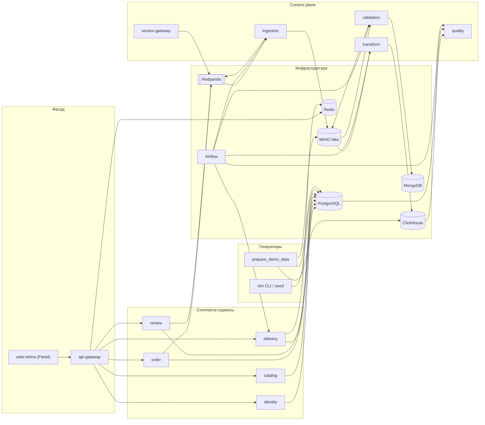

# Архитектура «Спутник Данные» (обзор)

Назначение: дать единую картину монорепозитория — контуры, потоки данных,
хранилища, профили запуска и наблюдаемость. Детали контрактов —
`specs/001-sputnik-data-portal/contracts/*.yaml`, сущности —
`specs/001-sputnik-data-portal/data-model.md`, требования —
`specs/001-sputnik-data-portal/spec.md`.

## Контуры

- **Commerce plane (US1/US3).** Фасад Panel → `api-gateway` → сервисы
  `identity`, `catalog`, `order`, `review`, `delivery`. Операционные данные —
  PostgreSQL, лимиты и идемпотентность — Redis.
- **Content plane (US2).** `sensor-gateway` → Redpanda
  (`sensors.readings.v1` / `sensors.readings.dlq`) → `ingestion` (bronze в
  MinIO) → `validation` (silver + отчёт качества) → `transform` (gold в
  ClickHouse) → `quality` (рейтинг в каталоге и Quality-page).
- **Orchestration.** Airflow 2.9 запускает DAGи `ingest_readings`,
  `refresh_quality`, `sync_provider_exports`, `deliver_subscription`
  идемпотентно, с `retries`/backoff и сенсорами свежести.
- **Observability.** structlog (JSON, сквозной `requestId`), OpenTelemetry,
  prometheus-client; Prometheus + Grafana (метрики лага/свежести, алерт
  деградации).

## Схема

## Поток данных (медальон)

1. `sensor-gateway` принимает чтение, **только он** проставляет `receivedAt`,
   публикует в `sensors.readings.v1` с ключом `stationId`; битые — в DLQ с
   причиной (`NULL_VALUE|OUT_OF_RANGE|SCHEMA_MISMATCH|DUPLICATE`).
2. `ingestion` пишет bronze (`lake/bronze/{provider}/{dt}`), дедуплицирует по
   `readingId` в Redis, архивирует DLQ (`lake/dlq/{topic}/{dt}/part-*.ndjson`).
3. `validation` чистит bronze → silver (Pandera), формирует отчёт качества
   (`lake/reports/quality/{dt}/report.json`); неконформные — в карантин.
4. `transform` строит gold: `fact_readings` + `mv_readings_hourly`,
   `mart_sales_daily`, `mart_quality_daily`, `mart_sentiment_daily`.
5. `quality` пересчитывает `qualityScore ∈ [0..1]` и публикует его в каталог и
   Quality-page.

## Профили запуска

| Профиль | Состав | Назначение |
| --- | --- | --- |
| `base` | PostgreSQL, Redis, commerce-сервисы, `web-vitrina`, seed | MVP US1 |
| `adv` | base + Redpanda, MinIO, ClickHouse, MongoDB, Airflow, Prometheus, Grafana, content plane | US2/US3 |
| `demo` | как `adv` + предзаготовленные данные (`prepare_demo_data.py`) | сквозная приёмка M0–M4 |

Одна команда: `docker compose --profile <base|adv|demo> up`.

## Наблюдаемость и безопасность

- Каждый сервис пишет structlog JSON с `requestId` и `traceId`; gateway
  генерирует `X-Request-Id` и прокидывает его вниз.
- Метрики: `consumer_lag_seconds`, `data_freshness_seconds`,
  `quality_degradation`, `quality_score` (`/metrics` на sensor-gateway и
  quality).
- PII изолирован в `identity.pii_vault` (application-level шифрование,
  `key_ref`), маскируется во всех выгрузках (`***@domain`), удаляется по сроку
  (по умолчанию 12 месяцев).
- Контракты — источник истины; `scripts/contract_lint.py` и CI блокируют
  несовместимый выпуск.

## Ссылки

- Runbook конвейера: `docs/runbooks/pipeline.md`.
- Runbook DLQ: `docs/runbooks/dlq.md`.
- Runbook живого потока: `docs/runbooks/streams.md`.
